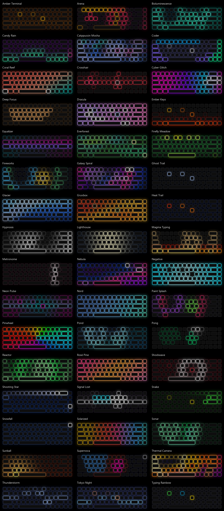

# KeyGlow community gallery

Lighting profiles for [KeyGlow](https://github.com/HiddenOnLies/KeyGlow), shared by the
community. They show up in the app under *Profiles → Community*.



## How KeyGlow uses it

- The app downloads **[`gallery.json`](gallery.json)**, one file with every profile, at most once
  a day. *Community → Check for new* downloads it right away.
- It's cached, so the gallery works offline, and every profile is **validated** before use.
  Profiles are plain JSON data, never code. A copy ships with the app for the first start.
- It can be turned off in KeyGlow: *Settings → Download new profiles from the KeyGlow community gallery*.

## Adding your profile

1. Make it in KeyGlow and save it. Your profiles are `.json` files in
   `Documents\KeyGlow\Perfiles`.
2. Fill in `author` (your name or GitHub user), a one-sentence `description` and a few `tags`:
   `animated`, `static`, `reactive` (reacts to typing), `gaming`, `chill`, `nature`, `neon`,
   `productivity`, `seasonal`, `theme`.
3. Put it in [`profiles/`](profiles) with a short lowercase file name (`my-profile.json`).
4. Check it and rebuild the bundle (needs KeyGlow from source: `pip install git+https://github.com/HiddenOnLies/KeyGlow`):

   ```bash
   keyglow gallery profiles --bundle gallery.json
   ```

5. Open a pull request. The automatic check runs the same validation.

Good gallery profiles:

- **Look different** from what's already here and from KeyGlow's built-in presets.
- **Work on any keyboard**: use key groups (`@wasd`, `@arrows`, `@numbers`…) or effects that
  cover the whole board, not a fixed list of LED numbers.
- **Look good on real LEDs**: pastel colors turn almost white on a keyboard, and very dark ones
  turn off. Test on your keyboard if you can.
- **Interactive profiles** use *On key press* layers (`reactive`): the key itself, a ripple
  from it, its whole row, its row and column (`cross`) or a burst from it (`burst`). With several colors, each press takes the next one. Stack them with
  `add` blending over a calm background.
- Don't use the `image` effect: it reads a file on your PC, so it can't be shared.

Themes are welcome when the palette's license allows it; add the palette and its license to
[`CREDITS.md`](CREDITS.md) (`tools/make_credits.py`).

## License

[MIT](LICENSE). By contributing a profile you agree to share it under the same license. The
theme palettes belong to their authors and are used under the MIT License; see
[`CREDITS.md`](CREDITS.md).
